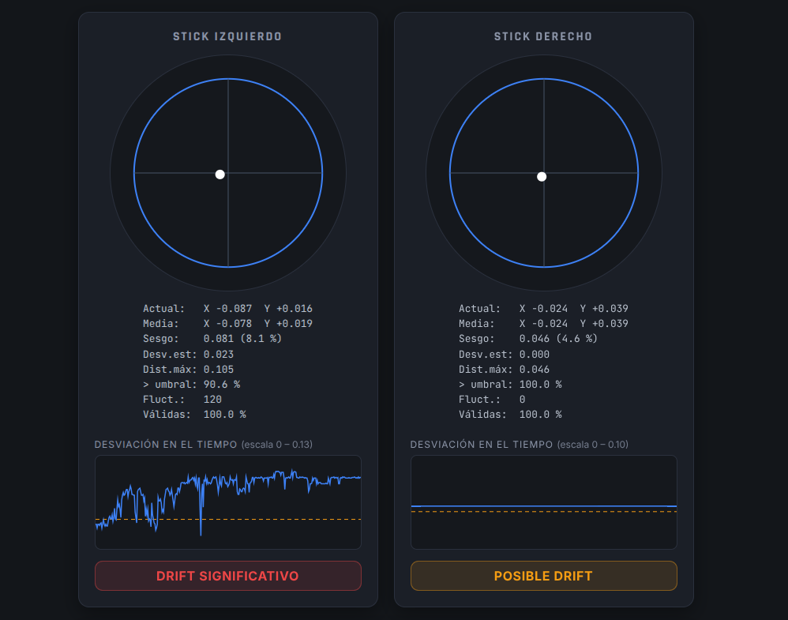
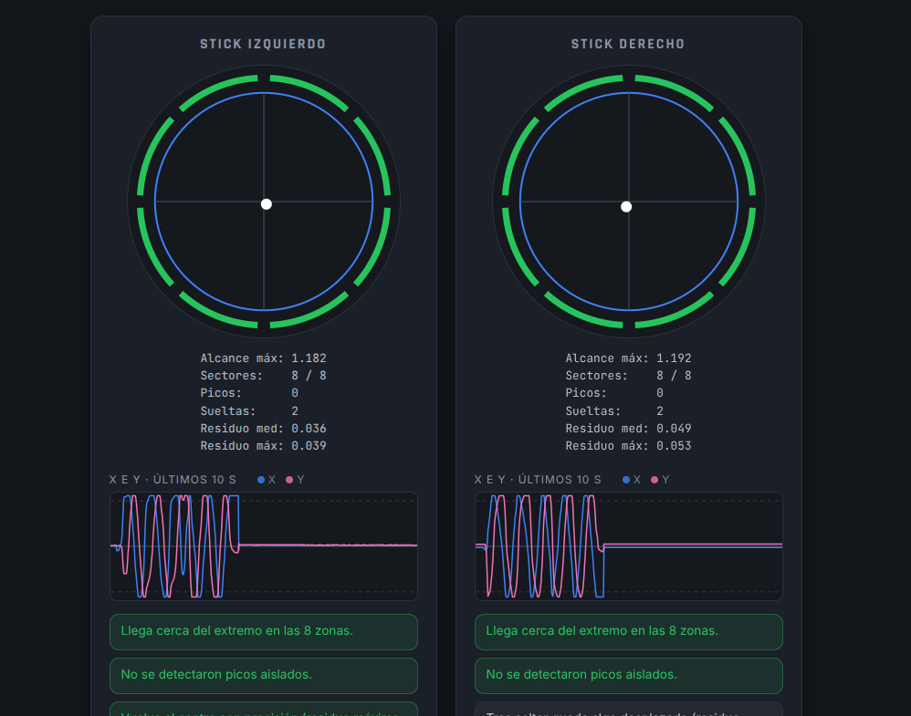

# DualSense Drift Tester

Herramienta web para comprobar si los sticks analógicos de un mando **DualSense (PS5)** presentan *drift*: desviaciones del centro o fluctuaciones cuando nadie los toca.

**Pruébala aquí:** https://albertofloram05.github.io/drift-tester-web/

> ⚠️ **Herramienta orientativa.** No sustituye una revisión física del mando. Las zonas muertas de los juegos pueden ocultar desviaciones pequeñas, y los resultados dependen de lo que el navegador y el sistema operativo reportan, no de una medida física del recorrido del stick.

## Capturas

### Modo estático



Prueba de drift con los sticks sueltos: estadísticas de cada stick, gráfica de la desviación con la línea del umbral y veredicto orientativo.

### Modo movimiento



Anillo de 8 sectores que se ilumina al llegar al borde en cada dirección, gráfica de X e Y de los últimos 10 segundos y observaciones sobre picos y vuelta al centro.

## Qué hace

Lee los ejes del mando en tiempo real mediante la **Gamepad API** del navegador y ofrece dos modos.

### Modo estático (prueba de drift)

Con los sticks sueltos, graba posiciones durante 10, 30, 60 o 120 segundos (tras una cuenta atrás de 5 s) y calcula, para cada stick:

- Posición media (X, Y) y **sesgo**: distancia entre el centro medio y el centro ideal.
- Desviación estándar y distancia máxima al centro.
- Porcentaje de muestras por encima de un **umbral configurable**.
- Número de fluctuaciones y porcentaje de lecturas válidas.

Con eso emite un veredicto orientativo por stick: **Normal**, **Posible drift** o **Drift significativo**. La decisión combina sesgo, persistencia y dispersión, de modo que un pico puntual no basta para marcar un stick como defectuoso. Incluye una gráfica de la desviación a lo largo de la prueba, con el umbral dibujado encima.

### Modo movimiento

Para comprobar el funcionamiento general de cada stick:

- Un anillo de **8 sectores** que indica si has llegado cerca del borde en cada dirección.
- Una gráfica de **X e Y** de los últimos 10 segundos.
- Detección de **picos aislados** (un valor que salta y vuelve en menos de 100 ms).
- Medición de si el stick **vuelve al centro** tras soltarlo.

Los resultados se presentan como observaciones («posible anomalía a revisar»), nunca como un defecto confirmado.

### Historial

Cada prueba estática se guarda en el navegador (`localStorage`) y puede exportarse a **CSV**.

## Cómo usarla

1. Conecta el mando por **USB** (con un cable que transmita datos) o por **Bluetooth**.
2. Abre la página en **Chrome o Edge** de escritorio.
3. **Pulsa cualquier botón del mando.** El navegador no expone el mando hasta que lo tocas.
4. Elige el modo y sigue las indicaciones en pantalla.

Para una prueba estática fiable: deja el mando sobre una superficie plana, suelta los sticks con suavidad y **repite la prueba varias veces**. Si el sesgo se repite, es un desplazamiento real del centro; si varía mucho, puede depender de cómo sueltas el stick.

## Privacidad

- Los datos de las pruebas **no se envían a ningún servidor**. Se procesan en tu navegador y el historial se guarda solo en él.
- La página carga tipografías desde **Google Fonts**, por lo que tu navegador hace esa petición al abrirla.

## Ejecutarla en local

No hay dependencias ni paso de compilación. Los módulos de JavaScript no funcionan abriendo el HTML con doble clic (`file://`), así que hace falta un servidor local sencillo:

```bash
git clone https://github.com/albertofloram05/drift-tester-web.git
cd drift-tester-web
python3 -m http.server 8000
```

Después abre http://localhost:8000. En Windows, si `python3` no existe, usa `python -m http.server 8000`.

## Estructura

```
drift-tester-web/
├── index.html
├── css/
│   └── styles.css
└── js/
    ├── app.js             # conecta todo: bucle, eventos y modos
    ├── gamepadReader.js   # lee el mando (Gamepad API)
    ├── stickStats.js      # estadísticas de un stick
    ├── evaluator.js       # veredicto del modo estático
    ├── driftTester.js     # máquina de estados de la prueba
    ├── motionAnalyzer.js  # análisis y observaciones del modo movimiento
    ├── history.js         # historial (localStorage) y exportación CSV
    └── render.js          # dibujo en canvas y formato de textos
```

La lógica (`stickStats`, `evaluator`, `driftTester`, `motionAnalyzer`) no depende del navegador ni de la página, así que se puede probar por separado desde la consola.

## Limitaciones

- **Los umbrales son valores iniciales**, no estándares. Los del modo estático (umbral del sesgo, 50 % y 80 % de persistencia) y los del modo movimiento (saltos, extremo, vuelta al centro) se eligieron como punto de partida y conviene calibrarlos con un mando que se sepa sano.
- **Los porcentajes son aproximaciones** de los valores que reporta el mando, no medidas físicas del recorrido.
- **La Gamepad API no garantiza una frecuencia de muestreo fija.** Las muestras se recogen en cada fotograma, así que dependen de la frecuencia de tu pantalla.
- **El eje horizontal de la gráfica estática reparte muestras, no segundos.** La gráfica del modo movimiento sí usa tiempo real.
- **No se garantiza identificar un DualSense original.** El nombre que muestra el navegador depende del sistema y del navegador.
- **Navegadores:** pensada para Chrome y Edge de escritorio. En otros navegadores la Gamepad API puede comportarse de otra forma y no se ha verificado.
- **El historial es de cada navegador.** Borrar los datos del sitio lo elimina. Para conservarlo, usa *Exportar CSV*.

## Origen del proyecto

Nació como una aplicación de escritorio en Java (JavaFX + LWJGL) y se reescribió en JavaScript para poder compartirla con un simple enlace.

## Licencia

Distribuido bajo la licencia MIT. Consulta el archivo [LICENSE](LICENSE) para más información.
