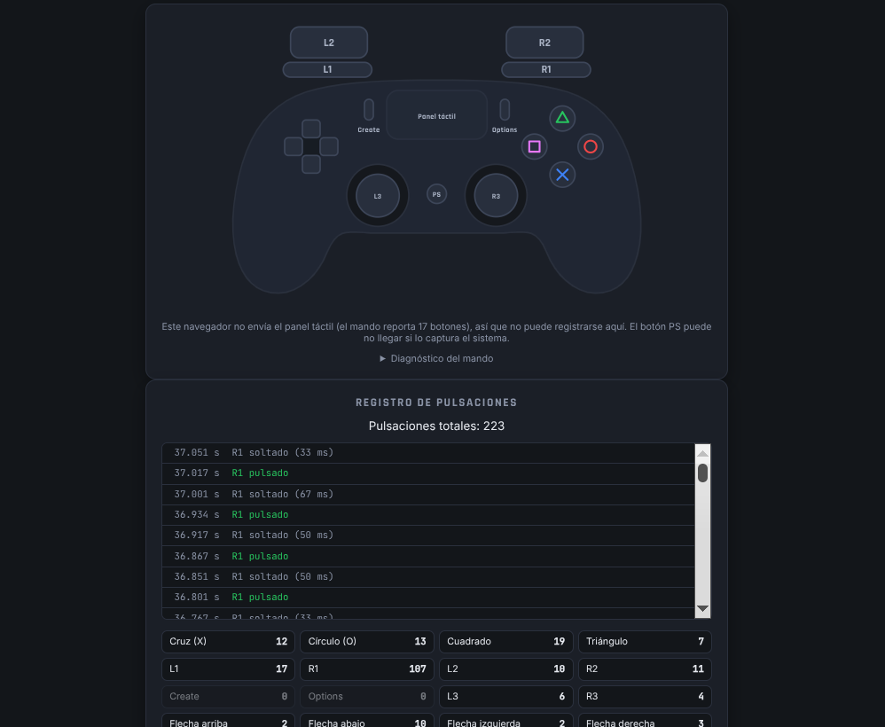
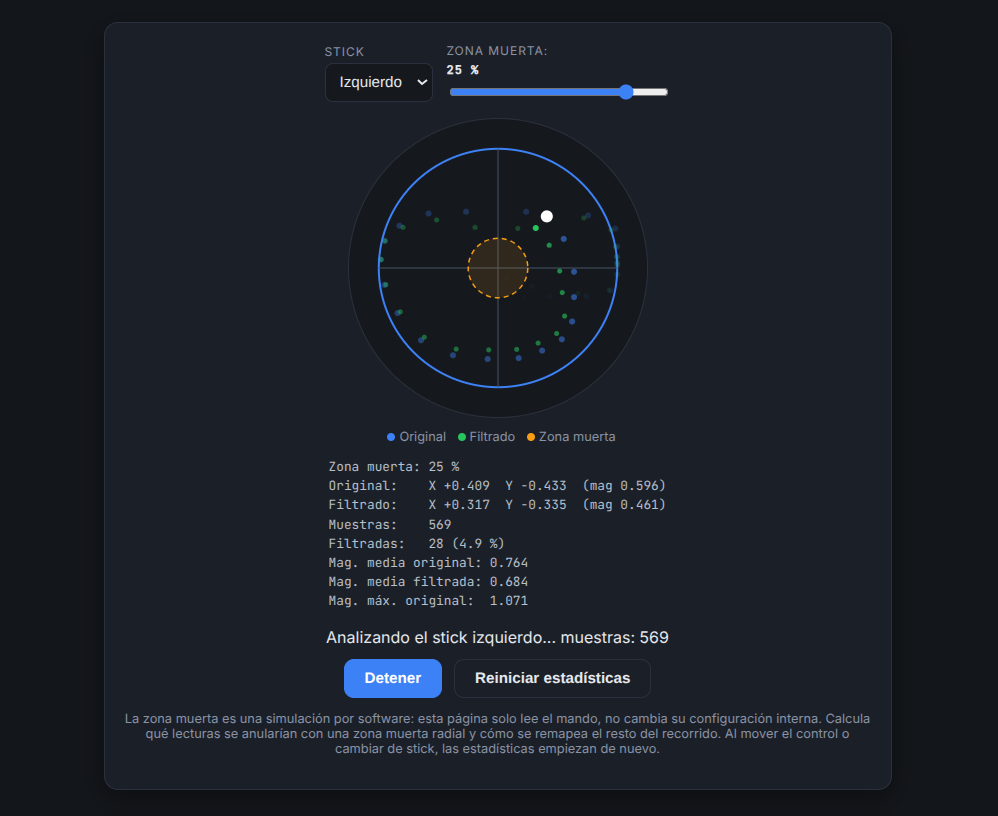

# DualSense Drift Tester

Herramienta web para comprobar si los sticks analógicos de un mando **DualSense (PS5)** presentan *drift*: desviaciones del centro o fluctuaciones cuando nadie los toca.

**Pruébala aquí:** https://drifttester.com/

> ⚠️ **Herramienta orientativa.** No sustituye una revisión física del mando. Las zonas muertas de los juegos pueden ocultar desviaciones pequeñas, y los resultados dependen de lo que el navegador y el sistema operativo reportan, no de una medida física del recorrido del stick.

## Capturas

### Modo estático


Prueba de drift con los sticks sueltos: estadísticas de cada stick, gráfica de la desviación con la línea del umbral y veredicto orientativo.

### Modo movimiento


Anillo de 8 sectores que se ilumina al llegar al borde en cada dirección, gráfica de X e Y de los últimos 10 segundos y observaciones sobre picos y vuelta al centro.

### Modo calibración


Anillo de 16 sectores que mide el centro real y el recorrido de cada stick y sugiere una zona muerta de partida.

### Modo botones



Mando dibujado que se ilumina al pulsar cada botón, con el registro de las pulsaciones.

### Modo zona muerta



Simulación de una zona muerta radial sobre las lecturas reales de un stick, con el movimiento original y el filtrado.

## Qué hace

Lee los ejes del mando en tiempo real mediante la **Gamepad API** del navegador y ofrece cinco modos.

### Modo estático (prueba de drift)

Con los sticks sueltos, graba posiciones durante 10, 30, 60 o 120 segundos (tras una cuenta atrás de 5 s) y calcula, para cada stick:

- Posición media (X, Y) y **sesgo**: distancia entre el centro medio y el centro ideal.
- Desviación estándar y distancia máxima al centro.
- Porcentaje de muestras por encima de un **umbral configurable**.
- Número de fluctuaciones y porcentaje de lecturas válidas.

Con eso emite un veredicto orientativo por stick: **Normal**, **Posible drift** o **Drift significativo**. La decisión combina sesgo, persistencia y dispersión, de modo que un pico puntual no basta para marcar un stick como defectuoso. Un stick inestable (desviación estándar mayor que 0,02) también se marca como posible drift, aunque su centro parezca correcto.

### Modo movimiento

Para comprobar el funcionamiento general de cada stick:

- Un anillo de **8 sectores** que indica si has llegado cerca del borde en cada dirección.
- Una gráfica de **X e Y** de los últimos 10 segundos.
- Detección de **picos aislados** (un valor que salta y vuelve en menos de 100 ms).
- Medición de si el stick **vuelve al centro** tras soltarlo.

Los resultados se presentan como observaciones («posible anomalía a revisar»), nunca como un defecto confirmado.

### Modo calibración

Mide el centro real y el recorrido de cada stick y sugiere una **zona muerta** de partida:

1. **Centro:** con los sticks sueltos (tras una cuenta atrás de 3 s), mide durante 5 s dónde está el centro de cada stick y cuánto tiembla. Si mueves un stick durante la medición, empieza de nuevo.
2. **Rango:** gira los dos sticks por todo el borde. Un anillo de **16 sectores** se ilumina al llegar al tope en cada dirección.
3. **Resultado:** para cada stick, el centro, el ruido, el alcance máximo, la circularidad del recorrido y una zona muerta sugerida, con observaciones en tres niveles (correcto, informativo y aviso).

La zona muerta sugerida cubre el sesgo del centro más 2,5 veces el ruido, con un mínimo de 0,05. Se ofrece también en porcentaje y en la versión «recentrando», para los programas que permiten además corregir el centro.

> **Es una calibración por software:** la página solo lee el mando. No puede cambiar su configuración interna ni arreglar el drift; solo mide y sugiere un valor de partida para los juegos o programas que permitan ajustar la zona muerta.

### Modo botones

Dibuja un mando que se ilumina al pulsar cada botón y registra las pulsaciones:

- **Mando dibujado:** los 17 botones del mapeo estándar (cruceta, botones de acción, L1/R1, L2/R2, L3/R3, Create, Options y PS) se iluminan al pulsarlos. Las tapas de los sticks se mueven con los ejes.
- **Gatillos analógicos:** L2 y R2 se rellenan según cuánto los aprietas, no solo cuando cuentan como pulsados.
- **Registro:** cada pulsación y cada suelta, con su hora desde que empezó el registro y cuánto tiempo estuvo pulsado el botón. La lista muestra los últimos 100 sucesos, el más reciente arriba.
- **Contadores** por botón y total de pulsaciones.
- **Diagnóstico:** un desplegable muestra cuántos botones envía el navegador y el índice de los que están pulsados.

> **Solo es fiable con el mapeo estándar.** Si el navegador no lo usa, la página lo avisa. **El panel táctil puede no registrarse:** es un botón extra que algunos sistemas no exponen. En Ubuntu, con Chrome, Edge, Brave y Firefox, el navegador envía 17 botones y el panel táctil no está entre ellos (el sistema lo usa como touchpad y mueve el cursor). Si no llega, se atenúa en el dibujo y la página lo indica. El botón PS también puede ser capturado por el sistema antes de llegar a la página.

### Modo zona muerta

Experimenta con una zona muerta sobre las lecturas reales de un stick y mira qué se filtra:

- **Stick** izquierdo o derecho, y **zona muerta** ajustable de 0 a 30 % con pasos de 1 punto.
- **Gráfica circular:** el círculo naranja es la zona muerta, el punto blanco es la lectura original y el verde, la filtrada, cada uno con su estela de medio segundo.
- **Algoritmo radial con remapeo:** si la magnitud `r` no supera la zona muerta `d`, la salida es (0, 0). Si la supera, se conserva la dirección y la magnitud pasa a `(r − d) / (1 − d)`, limitada a 1, para que el stick siga alcanzando su recorrido completo.
- **Estadísticas** mientras dura la prueba: muestras, muestras filtradas (número y porcentaje), magnitud media original y filtrada, y magnitud máxima original.

Al mover el control o cambiar de stick las estadísticas empiezan de nuevo, porque las muestras anteriores usaron otra zona muerta. Si el mando se desconecta con la prueba en marcha, se detiene y conserva lo recogido. Los detalles del cálculo están en [docs/zona-muerta.md](docs/zona-muerta.md).

> **Es una simulación por software:** la página solo lee el mando. No cambia su configuración interna ni aplica nada de forma permanente.

### Historial

Cada prueba estática se guarda en el navegador (`localStorage`) y se añade sola a una **tabla de resultados** que se actualiza al terminar la prueba, sin recargar la página. Además, el historial puede exportarse a **CSV**.

- **Una fila por stick y prueba:** número, fecha y hora, stick, muestras, sesgo X, sesgo Y, desviación estándar, porcentaje de muestras sobre el umbral, umbral y resultado. La prueba más reciente aparece arriba.
- **Mismos datos que el CSV:** la tabla lee el historial guardado y no recalcula nada, así que ambos coinciden. El número de prueba es su posición en el historial. El CSV no cambia de formato y no incluye el sesgo X e Y por separado.
- **Persiste entre sesiones**, porque el historial vive en el navegador. «Borrar historial» vacía la tabla y el historial; reiniciar una medición no los toca.
- En pantallas estrechas la tabla se desplaza en horizontal.

Las pruebas guardadas antes de la v1.5.0 no tienen sesgo X e Y por separado y muestran una raya en esas dos columnas.

## Cómo usarla

1. Conecta el mando por **USB** (con un cable que transmita datos) o por **Bluetooth**.
2. Abre la página en **Chrome, Brave, Edge o Firefox** de escritorio.
3. **Pulsa cualquier botón del mando.** El navegador no expone el mando hasta que lo tocas.
4. Elige el modo y sigue las indicaciones en pantalla.

Para una prueba estática fiable: deja el mando sobre una superficie plana, suelta los sticks con suavidad y **repite la prueba varias veces**. Si el sesgo se repite, es un desplazamiento real del centro; si varía mucho, puede depender de cómo sueltas el stick.

## Privacidad

- Los datos de las pruebas **no se envían a ningún servidor**. Se procesan en tu navegador y el historial se guarda solo en él.
- La página **no carga recursos de terceros** (las tipografías se sirven desde el propio proyecto). El hosting es GitHub Pages, que, como cualquier servidor, recibe las visitas.

## Ejecutarla en local

No hay dependencias ni paso de compilación. Los módulos de JavaScript no funcionan abriendo el HTML con doble clic (`file://`), así que hace falta un servidor local sencillo:

```bash
git clone https://github.com/albertofloram05/drift-tester-web.git
cd drift-tester-web
python3 -m http.server 8000
```

Después abre http://localhost:8000. En Windows, si `python3` no existe, usa `python -m http.server 8000`.

## Estructura

```
drift-tester-web/
├── index.html
├── favicon.png
├── css/
│   └── styles.css
├── js/
│   ├── app.js                # conecta todo: bucle, eventos y modos
│   ├── gamepadReader.js      # lee el mando (Gamepad API)
│   ├── stickStats.js         # estadísticas de un stick
│   ├── evaluator.js          # veredicto del modo estático
│   ├── driftTester.js        # máquina de estados de la prueba
│   ├── motionAnalyzer.js     # análisis y observaciones del modo movimiento
│   ├── calibration.js        # centro, rango, zona muerta y observaciones de la calibración
│   ├── calibrationWizard.js  # máquina de estados del asistente de calibración
│   ├── deadzone.js           # zona muerta radial y estadísticas del modo zona muerta
│   ├── buttonTracker.js      # tabla de botones y registro de pulsaciones
│   ├── history.js            # historial (localStorage) y exportación CSV
│   ├── level.js              # niveles del veredicto
│   └── render.js             # dibujo en canvas y formato de textos
├── fonts/                    # tipografías, servidas desde el propio sitio
└── docs/
    ├── calibracion.md
    ├── zona-muerta.md    
    ├── modo-estatico.png
    ├── modo-movimiento.png
    ├── modo-calibracion.png
    ├── modo-botones.png
    ├── modo-zona-muerta.png
    └── og-image.png
```

La lógica (`stickStats`, `evaluator`, `driftTester`, `motionAnalyzer`, `calibration`, `calibrationWizard`, `buttonTracker`, `deadzone`) no depende del navegador ni de la página, así que se puede probar por separado desde la consola.

## Limitaciones

- **Umbrales:** comprobados de forma orientativa con cinco mandos (dos con síntomas) en una sola sesión; el detalle está en [docs/calibracion.md](docs/calibracion.md). Siguen sin ser un estándar y conviene repetir la prueba varias veces.
- **Modo calibración:** la zona muerta sugerida (sesgo + 2,5 × ruido, mínimo 0,05), los límites de zona muerta «normal» y «alta» (0,10 y 0,25) y los de circularidad (0,90 y 0,80) son valores iniciales que no se han calibrado con una muestra de mandos. Tómalos como punto de partida; el detalle está en [docs/calibracion.md](docs/calibracion.md).
- **Modo zona muerta:** es una simulación radial sobre las lecturas del navegador. Muchos juegos usan zonas muertas por ejes u otras curvas, así que el resultado en un juego concreto puede diferir. No corrige el centro del stick: el círculo está en el (0, 0) ideal. Si el stick no llega a 1 en su recorrido, la salida filtrada tampoco llegará a 1. Las estadísticas cuentan fotogramas con lectura, no informes únicos del mando.
- **Tabla de resultados:** depende de `localStorage`. Si el navegador lo bloquea, la prueba no se guarda y la tabla queda vacía; la página lo avisa al terminar la prueba.
- **Los porcentajes son aproximaciones** de los valores que reporta el mando, no medidas físicas del recorrido.
- **La Gamepad API no garantiza una frecuencia de muestreo fija.** Las muestras se recogen en cada fotograma, así que dependen de la frecuencia de tu pantalla.
- **El eje horizontal de la gráfica estática reparte muestras, no segundos.** La gráfica del modo movimiento sí usa tiempo real.
- **No se garantiza identificar un DualSense original.** El nombre que muestra el navegador depende del sistema y del navegador.
- **Navegadores:** probada con un DualSense en Chrome, Brave y Firefox de escritorio. Edge usa el mismo motor que Chrome y debería comportarse igual, pero no se ha verificado. En móviles y otros navegadores la Gamepad API puede variar.
- **Otros mandos:** pensada para el DualSense. Los mandos que el navegador reconoce con el mapeo estándar también muestran sus ejes (una persona probó uno de Nintendo Switch), pero los umbrales se calibraron pensando en el DualSense y no se ha validado la fiabilidad con otros modelos.
- **El historial es de cada navegador.** Borrar los datos del sitio lo elimina. Para conservarlo, usa *Exportar CSV*.

## Origen del proyecto

Nació como una aplicación de escritorio en Java (JavaFX + LWJGL) y se reescribió en JavaScript para poder compartirla con un simple enlace.

## Apoyar el proyecto

Es gratuito y sin anuncios. Si te resulta útil, puedes [invitarme a un café](https://ko-fi.com/albertofloram05).

## Licencia

Distribuido bajo la licencia MIT. Consulta el archivo [LICENSE](LICENSE) para más información.
